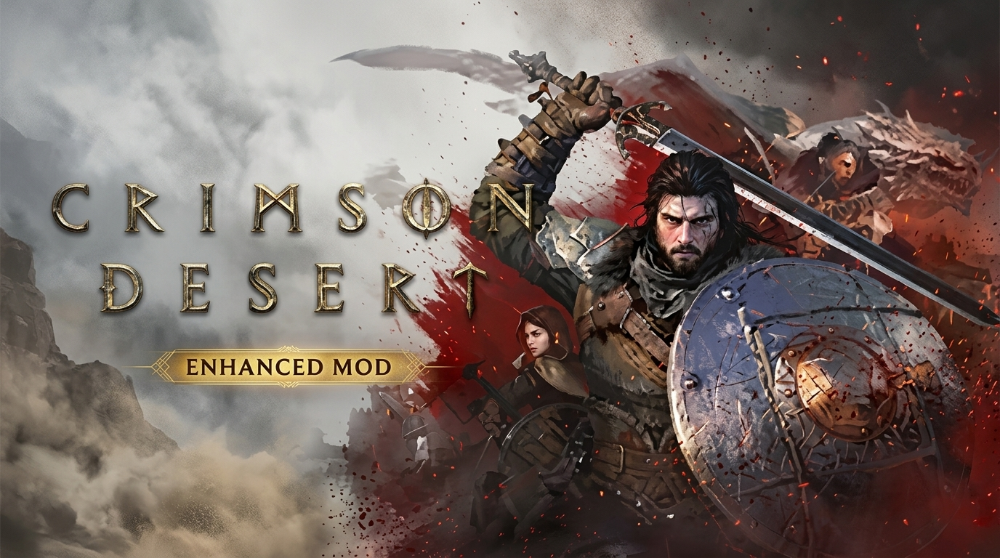

# ⚔️ Crimson Desert Enhanced: Ultimate QoL & Customization Mod Collection

  

  

  
  
  
  

  <b>⬇ DOWNLOAD THE MOD PACK ⬇</b>

  

  
  

  

> ⚔️ **Your complete toolkit for Crimson Desert Enhanced** — customize your HUD, edit your build, and explore Pywel with improved visibility and new skills. Designed for **single-player offline** play. 🛡️ **NO MEMORY INJECTION** — this repository contains client-side mods and configuration tweaks only. No aimbots or game-breaking cheats.

## 📖 About the Game

**Crimson Desert** is the open-world action RPG developed by **Pearl Abyss**. You play as **Kliff**, a warrior fighting to restore the Greymane clan and save the world from a mysterious threat.

In August 2026, Pearl Abyss released the **Crimson Desert Enhanced** update (Patch 2.00.00). This massive free update reworks the main story with new cutscenes, adds eight new Kliff skills, introduces the **Abyss Link** system for easier progression across characters, and adds five new voice languages. The update has been praised for fixing many of the game's launch issues, with recent Steam reviews sitting at 77% positive.

**Key Enhanced Features**:
- 📖 **Reworked Story** — New cutscenes, dialogue, and Memory Fragments
- 🔗 **Abyss Link** — Learn skills on one character, get equivalent currency for others
- ⚔️ **Eight New Kliff Skills** — Including Water Stride and Enhanced Flight
- 🎮 **New Flying Mount Controls** — Camera-based or manual mode
- 🌍 **Five New Voice Languages** — German, French, Spanish, Japanese, Brazilian Portuguese

## ⚠️ IMPORTANT WARNING — READ BEFORE USING

**Crimson Desert Enhanced is a single-player game with no competitive multiplayer.**

| Enforcement Risk | Details |
|------------------|---------|
| **Single-Player Safe** | No anti-cheat system for offline play |
| **Client-Side Mods Only** | This repository contains mods that modify local files — no memory injection |
| **Ban Risk** | **ZERO in single-player** — no online competitive modes |

> ⚠️ **Important**: The game has no anti-cheat. However, using **memory editors (trainers)** can corrupt your save files. This repository focuses on **safe, client-side mods** that enhance the game without breaking it. Always back up saves before installing mods.

## 🔒 Safety & Security

| Safety Feature | Description |
|----------------|-------------|
| **No Memory Injection** | This repo contains no trainers or memory editors |
| **ASI Loader Based** | Uses the standard ASI Loader for Unreal Engine mods |
| **No Network Code** | Mods contain no telemetry or online hooks |
| **Backup Recommended** | Always back up saves before installing major mods |

## 🔥 Featured Mods

### 🎨 Enhanced Lod - Internal Graphics Overhaul v4.1

**Source:** Nexus Mods (Dedenderr & VAXIStaa) | **Version:** 4.1 | **Updated:** September 10, 2026

A graphics overhaul project that fixes Level of Detail (LOD) issues, enhances global illumination, shadows, and more.

**Features**:
- **LOD Fixes** — Corrects distant object rendering
- **Enhanced Global Illumination** — Better lighting
- **Improved Shadows** — Higher quality shadows
- **ASI Loader** — Standard mod loader

**Installation**:
1. Download the archive.
2. Extract all contents to `C:\Program Files (x86)\Steam\steamapps\common\Crimson Desert\bin64`.
3. Launch the game.

> ⚠️ **Note**: Do **NOT** use DMM. Only extract the contents of folder 1 into the bin64 folder.

### 🌍 Seasons of Pywel (Fan-Made Mod)

**Source:** Nexus Mods (Khione95) | **Version:** 1.0 | **Updated:** October 2026

A complete seasonal system that changes the visual landscape of Pywel based on the in-game calendar.

**Features**:
- **Four Seasons** — Summer, Autumn, Winter, Spring
- **Dynamic Changes** — Trees, grass, and terrain change with seasons
- **Temperature Effects** — Each season has its own temperature modifier (Winter is 24 degrees colder)
- **Weather System** — Each season has its own weather probabilities
- **Customizable Duration** — Choose season length (3, 7, 14, 45, 60, or 90 days)

**Installation**:
1. Download from Nexus Mods.
2. Extract to the game folder.
3. Configure via the in-game menu.

### 🛠️ FLiNG Customization Script (+12 Features)

**Source:** FLiNG / PlayGround.ru | **Version:** v1.0-v2.x+ | **Updated:** September 8, 2026

A lightweight script with 12 features for customization and offline testing.

**Features**:
- **Infinite Health** — Never die
- **Infinite Stamina** — Never tire
- **Infinite Spirit** — Unlimited abilities
- **Edit Max Health/Stamina/Spirit** — Customize your stats
- **Edit Defense** — Adjust damage reduction
- **Edit Selected Item/Money** — Modify inventory
- **Game Speed** — Control time flow
- **Super Damage / One-Hit Kill** — Instant elimination
- **Freeze Time** — Lock day/night cycle
- **+1 Hour** — Advance time

**Installation**:
1. Copy all files from the archive to the game root folder.
2. Launch the script first, then the game.
3. Use the assigned hotkeys during gameplay.

> ⚠️ **Note**: Use only in single-player mode. Using in online/multiplayer may result in account restrictions.

### 🧪 Community Mods (Nexus Mods)

Several community mods are available for different playstyles.

| Mod | Description |
|-----|-------------|
| **Indonesian Language Mod** | Full text translation (190,000+ strings) by Deerimpact |
| **Various QoL Tweaks** | Community-created mods for UI, inventory, and progression |

## 🚀 QUICK START

### Method 1 — Enhanced Lod (Recommended for Visuals)

1. **Download** the Enhanced Lod archive from Nexus Mods.
2. **Close** the game completely.
3. **Extract** all contents to `Steam\steamapps\common\Crimson Desert\bin64`.
4. **Launch** the game.

### Method 2 — Seasons of Pywel

1. **Download** the mod from Nexus Mods.
2. **Extract** to the game folder.
3. **Configure** season duration via the in-game menu.

### Method 3 — FLiNG Script (Customization)

1. **Download** the archive from the button above.
2. **Extract** to the game root folder.
3. **Launch** the script first, then the game.
4. **Use hotkeys** to activate features.

> ⚠️ **Antivirus warning?** This is a false positive because the tool reads game memory. Add the file to your exceptions list.

### 📁 Folder Structure

### ⚠️ Important Notes
- **Backup your saves** before installing any mod.
- **Admin rights** are required for full functionality.
- **Works with Steam version** of Crimson Desert Enhanced.
- **Compatible with game version 2.00.00** (Enhanced update).
- **Single-player only** — no multiplayer.
- **Add the tool folder to antivirus exclusions** to prevent false positives.

## ❓ FAQ

### ❓ Is this a cheat or trainer?
**No.** This repository focuses on **graphics mods, seasonal overhauls, and customization scripts** for offline testing. It does not contain aimbots or game-breaking cheats.

### ❓ Will I get banned?
**No.** Crimson Desert Enhanced is a single-player game with no anti-cheat. Use mods freely in offline mode.

### ❓ Does it work with the latest Enhanced update?
**Yes.** The mods listed are updated for game version **2.00.00** (Enhanced update, August 2026).

### ❓ Does it work on Windows 11?
**Yes.** Fully compatible with Windows 10 and 11 (64-bit).

### ❓ What is the Abyss Link system?
**Abyss Link** is a new currency introduced in the Enhanced update. When you spend an Abyss Artifact to learn a skill on one character, the other playable characters receive an equivalent amount of Abyss Links, making progression across all three characters much less restrictive.

### ❓ How to uninstall?
- Enhanced Lod: Delete the `.asi` file from `bin64`.
- Seasons: Delete the mod folder.
- FLiNG Script: Delete the trainer folder.

### ❓ What if the mod doesn't work?
- Ensure the game is updated to version 2.00.00.
- Check for conflicts with other mods.
- Verify the `.asi` file is in the correct folder.
- Run the script as administrator.

## 🛠️ System Requirements

Based on official Epic Games Store data:

| Component | Minimum | Recommended |
|-----------|---------|-------------|
| **OS** | Windows 10 (64-bit) | Windows 11 (64-bit) |
| **Processor** | AMD Ryzen 5 2600X / Intel Core i5-8500 | AMD Ryzen 5 5600 / Intel Core i5-11600K |
| **RAM** | 16 GB | 16 GB+ |
| **GPU** | AMD RX 5500 XT / NVIDIA GTX 1060 | AMD RX 6700 XT / NVIDIA RTX 2080 |
| **Storage** | 150 GB SSD (game) + 100 MB (mods) | 150 GB SSD (game) + 100 MB (mods) |
| **DirectX** | Version 12 | Version 12 |

## 📢 Disclaimer

> **Fan-made mod collection.** Not affiliated with Crimson Desert Enhanced developers, Pearl Abyss, or any publisher.
>
> **Use at your own risk.** The author is not responsible for save corruption, crashes, or damage.
>
> **Single-player only** — use freely in offline mode.
>
> **Back up your saves before use!**

## 🌟 Support This Project

- ⭐ **Star** this repository
- 🔔 **Watch** for updates
- 🐞 **Report** issues
- 💬 **Share** with friends!

© 2026 • Crimson Desert Enhanced • QoL & Customization Mods
